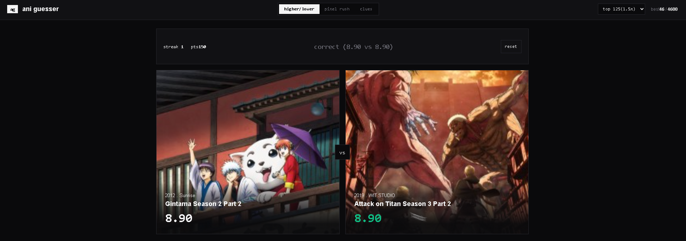

# ani guesser

**A fast anime guessing game for the browser. Compare ratings, decode pixelated posters and solve mystery clues, all with real data from public anime APIs.**


*Higher/lower mode: two anime, one hidden rating, and a streak to protect. The ratings are revealed after every answer.*

## About the project

ani guesser is a small web game made with plain HTML, CSS and JavaScript. There is no framework, no build step, no backend and no API key. You open the page and you can play.

It has three game modes:

| Mode | What you do |
| --- | --- |
| **Higher / lower** | Two anime appear. Guess if the one on the right is rated higher or lower than the one on the left. |
| **Pixel rush** | A poster starts as huge pixel blocks and slowly sharpens. Name the anime before time runs out. |
| **Clues** | Work out the anime from clues (year, studio, genres, rating). Fewer clues means more points. |

Anime data and posters are loaded live from the [Jikan API](https://jikan.moe/) (an unofficial MyAnimeList API), with the [AniList](https://anilist.co/) API as an automatic backup.

## Why I made it

I wanted to build a game that is fun for a few minutes at a time, and the "how well do I really know anime ratings?" idea felt like a good fit. It was also a good way to practice real-world JavaScript instead of only static pages:

- fetching live data with `async`/`await`
- handling rate limits, timeouts and failures (a backup API, retries, and cached data)
- keeping several game modes organized in separate files
- saving progress in the browser with `localStorage`
- building the interface and animations by hand, without a framework

## How to run it

There is nothing to install.

1. Download or clone the project:
   ```bash
   git clone <your-repository-url>
   cd anime
   ```
2. Open `index.html` in your browser.
   - Or serve the folder with any static server, for example the **Live Server** extension in VS Code, or:
     ```bash
     python -m http.server 8000
     ```
     then open `http://localhost:8000`.

You need an internet connection the first time, because the anime list and posters are loaded from the APIs.

## How to play

Use the tabs at the top to switch modes, and the dropdown in the top right to choose the pool: **top 50** (1x points) or **top 125** (1.5x points in higher/lower).

### Higher / lower
- Click **higher** or **lower**, or use the keyboard: `↑` / `W` for higher, `↓` / `S` for lower.
- A correct answer gives you 100 points (times the pool bonus) and the game moves on by itself.
- A wrong answer ends the run. Press **play again** or **reset**.
- Equal ratings count as correct.

### Pixel rush
- The poster sharpens over 15 seconds. Pick the right title from 4 choices.
- A hint shows the release year and studio.
- Points = seconds left × 10, so answering faster scores more.
- **next** loads a new poster.

### Clues
- Only the first clue is open at the start, and a correct guess is worth 400 points.
- **unlock clue** reveals the next one, but costs 100 points (minimum 100).
- Pick the right title from 4 choices. **next** starts a new round.

Your best streak and best points are shown in the top right and are saved in your browser, so they are still there after a refresh.

## How it works

- **Data:** Jikan is used first. If it fails or is rate limited, the game switches to AniList for a minute.
- **Throttling:** requests are spaced about 1.2 seconds apart and retried once on errors or timeouts.
- **Caching:** each page of results is saved in `localStorage` for 6 hours, so the game loads quickly and can still run if both APIs are down.
- **Safety:** all anime titles and studio names go through an `esc()` helper before they are put into the page.

## Project structure

```
anime/
├── index.html      page layout: tabs, panels, script tags
├── style.css       styling
├── screenshots/    images used in this README
└── js/
    ├── util.js     esc() helper that escapes text before it goes into HTML
    ├── limits.js   all settings: API urls, timings, pools, point values
    ├── store.js    best score saved in localStorage
    ├── api.js      fetching, throttling, backup source and caching
    ├── hl.js       higher / lower game
    ├── px.js       pixel rush game
    ├── clues.js    clues game
    ├── app.js      tabs, pool selector, keyboard controls, startup
    └── deck.js     unfinished tier-list idea, not loaded by index.html
```

Scripts load in the order listed in `index.html`, because each file uses the ones before it.

## Known limitations

- In rare cases a higher/lower pair can mix ratings from different sources (MAL and AniList), which use slightly different scales.
- The best-points score is shared by all three modes.
- Pixel rush and clues totals reset when you refresh. Only the best score is saved.
- `deck.js` is an early, unfinished experiment.

## Ideas for the future

- A tier-list mode (the unfinished `deck.js`)
- Separate best scores for each mode
- Online leaderboards

## Credits

Anime data and posters belong to their respective owners and come from the Jikan and AniList APIs. This project is not affiliated with MyAnimeList or AniList.
