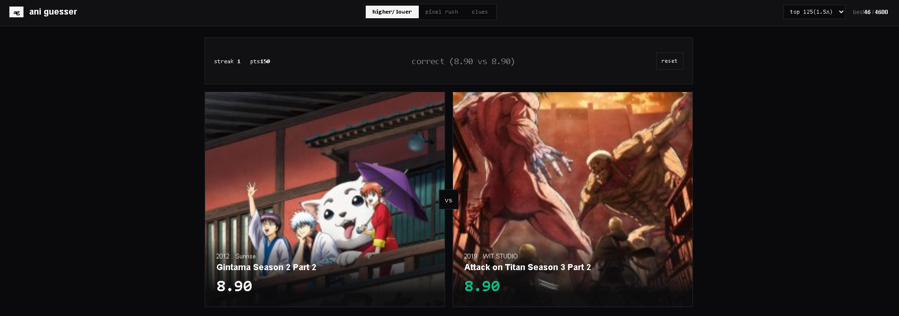

# ani guesser

**A fast anime guessing game for the browser. Compare ratings, decode pixelated posters, solve mystery clues and take on a new daily challenge every day, all with real data from public anime APIs.**


*Higher/lower mode: two anime, no ratings on screen, and a streak to protect. Both ratings are revealed after every answer.*

## About the project

ani guesser is a small web game made with plain HTML, CSS and JavaScript. There is no framework, no build step, no backend and no API key. You open the page and you can play. It can also be installed like an app and keeps working offline.

It has four game modes:

| Mode | What you do |
| --- | --- |
| **Higher / lower** | Two anime appear with no ratings shown. Guess if the one on the right is rated higher or lower than the one on the left. |
| **Pixel rush** | A poster starts as huge pixel blocks and slowly sharpens. Name the anime before time runs out. |
| **Clues** | Work out the anime from clues (year, studio, genres, rating). Fewer clues means more points. |
| **Daily** | Five questions that are the same for everyone, mixing clues, pixelated posters and higher/lower. One try per day, with a streak. |

Anime data and posters are loaded live from the [Jikan API](https://jikan.moe/) (an unofficial MyAnimeList API), with the [AniList](https://anilist.co/) API as an automatic backup.

## Features

- **Four difficulty levels** (easy, medium, hard, brutal) that change the pool of anime and the point multiplier.
- **Daily challenge** with a day-streak counter and a 14-day history grid.
- **Share buttons** in every mode. They open the phone's share sheet, or copy the result on a computer.
- **Best scores per mode and level**, saved in your browser.
- **Stats panel** with answers and accuracy for each mode.
- **Sound effects** made in the browser (no audio files), with a mute button that remembers your choice.
- **Short vibration** on phones that allow it.
- **Keyboard shortcuts** for fast play.
- **Installable and offline-ready** (see "Install it as an app").

## Why I made it

I wanted to build a game that is fun for a few minutes at a time, and the "how well do I really know anime ratings?" idea felt like a good fit. It was also a good way to practice real-world JavaScript instead of only static pages:

- fetching live data with `async`/`await`
- handling rate limits, timeouts and failures (a backup API, retries, and cached data)
- keeping several game modes organized in separate files
- saving progress in the browser with `localStorage`
- building the interface and animations by hand, without a framework
- making a seeded random generator so everyone gets the same daily challenge
- turning a website into an installable, offline-ready app with a manifest and a service worker

## How to run it

There is nothing to install.

1. Download or clone the project:
   ```bash
   git clone <your-repository-url>
   cd anime
   ```
2. Serve the folder with any static server, for example the **Live Server** extension in VS Code, or:
   ```bash
   python -m http.server 8000
   ```
   then open `http://localhost:8000`.

You can also open `index.html` directly to play, but the install and offline features only work on `http://localhost` or `https`, not on a `file://` address.

You need an internet connection the first time, because the anime list and posters are loaded from the APIs.

## How to play

Use the tabs at the top to switch modes, and the dropdown in the top right to choose the level:

| Level | Anime pool | Points |
| --- | --- | --- |
| easy | top 50 | 1x |
| medium | top 150 | 1.5x |
| hard | top 300 | 2x |
| brutal | top 500, with pairs that are rated very close together | 3x |

### Higher / lower
- Click **higher** or **lower**, or use the keyboard.
- A correct answer gives you 100 points (times the level bonus) and the game moves on by itself.
- A wrong answer ends the run. Press **play again** or **reset**.
- Equal ratings count as correct.

### Pixel rush
- The poster sharpens over 15 seconds. Pick the right title from 4 choices.
- A hint shows the release year and studio.
- Points = seconds left × 10 × the level bonus, so answering faster scores more.
- **next** loads a new poster.

### Clues
- Only the first clue is open at the start, and a correct guess is worth 400 points.
- **unlock clue** reveals the next one, but costs 100 points (minimum 100).
- Pick the right title from 4 choices. **next** starts a new round.

### Daily
- Five rounds, 100 points each (500 at most). The rounds are a mix of clues, pixelated poster and higher/lower, and each type shows up at least once.
- Everyone gets the same questions on the same day. The questions are picked from the date, so no server is needed.
- You can play it once a day. Your progress is saved, so a refresh does not give you another try.
- Finishing the daily keeps your **streak**: days in a row you finished it, whatever your score. Missing a day resets it. The **history grid** shows your last 14 days, with brighter green for higher scores.
- **share** gives you a result like this:
  ```
  ani guesser daily 2026-11-16 🔥3
  🟩🟩🟥🟩🟥 300/500
  ```
- A new daily starts at midnight UTC.

### Keyboard shortcuts

| Keys | Where | What it does |
| --- | --- | --- |
| `↑` / `W` | higher/lower | higher |
| `↓` / `S` | higher/lower | lower |
| `1` to `4` | pixel rush, clues, daily | pick that answer |
| `Enter` | pixel rush, clues, daily | next (in pixel rush, only after the round ends) |
| `U` | clues | unlock a clue |
| `Esc` | anywhere | close the stats or install window |

Your best streak and best points are shown in the top right and are saved in your browser for each mode and level, so they are still there after a refresh. The **stats** button shows how many answers you have given in each mode and your accuracy.

## Install it as an app

ani guesser is a PWA (progressive web app), so you can install it and play it like an app. The **how to install** button in the game shows the same steps.

1. Open the game's website once while online.
2. **Computer (Chrome or Edge):** click the install icon at the right end of the address bar.
3. **Android (Chrome):** open the menu and tap **Install app**.
4. **iPhone (Safari):** tap Share, then **Add to Home Screen**.
5. Open the game from the new icon on your desktop or home screen.

After the first visit, the game files are saved in your browser, so the game opens even without internet.

## How it works

- **Data:** Jikan is used first. If it fails or is rate limited, the game switches to AniList for a minute.
- **Throttling:** requests are spaced about 1.2 seconds apart and retried once on errors or timeouts.
- **Caching:** each page of results is saved in `localStorage` for 6 hours, so the game loads quickly and can still run if both APIs are down.
- **Offline:** a service worker (`sw.js`) saves the game files and serves them when the network fails. It tries the network first, so updates reach players as soon as they are online. It also keeps up to 40 posters.
- **Daily challenge:** today's date becomes a number (the seed), and a small seeded random generator uses it to pick the same anime and the same order for everyone. Streak and history are saved in `localStorage`.
- **Best scores:** saved per mode and level under keys such as `h1:easy` or `px:hard`. The daily has one record.
- **Safety:** all anime titles and studio names go through an `esc()` helper before they are put into the page.

## Project structure

```
anime/
├── index.html      page layout: tabs, panels, popups, script tags
├── style.css       styling
├── manifest.json   app name, colors and icons for installing
├── sw.js           service worker: offline files and poster cache
├── icons/          app icons
├── screenshots/    images used in this README
└── js/
    ├── util.js     esc(), shuffle(), seeded random for the daily, vibration, sharing
    ├── sfx.js      sound effects and the mute setting
    ├── limits.js   all settings: API urls, timings, levels, point values
    ├── store.js    best scores per mode and level in localStorage
    ├── stats.js    answer counts, accuracy and the stats window
    ├── api.js      fetching, throttling, backup source and caching
    ├── hl.js       higher / lower game
    ├── px.js       pixel rush game
    ├── clues.js    clues game
    ├── daily.js    daily challenge, streak and history grid
    ├── app.js      tabs, level selector, keyboard controls, startup
    └── deck.js     unfinished tier-list idea, not loaded by index.html
```

Scripts load in the order listed in `index.html`, because each file uses the ones before it.

## Known limitations

- In rare cases a higher/lower pair can mix ratings from different sources (MAL and AniList), which use slightly different scales.
- The daily challenge is built from the first two pages of the top anime list. If a player gets the data from the backup API, or the list changes between two visits, their questions can differ from other players'.
- The daily uses UTC for the date, so the new day starts at midnight UTC wherever you are.
- Stats only count answers given after the stats feature was added.
- Pixel rush and clues totals reset when you refresh or change level. Only the best scores are saved.
- Offline play needs one online visit first. Posters you have not seen before may be missing offline, and only the latest 40 are kept.
- Vibration only works on phones whose browser allows it.
- `deck.js` is an early, unfinished experiment.

## Ideas for the future

- A tier-list mode (the unfinished `deck.js`)
- A "release year sort" mode
- Achievements and badges
- Online leaderboards (this needs a backend and a database)

## Credits

Anime data and posters belong to their respective owners and come from the Jikan and AniList APIs. This project is not affiliated with MyAnimeList or AniList.